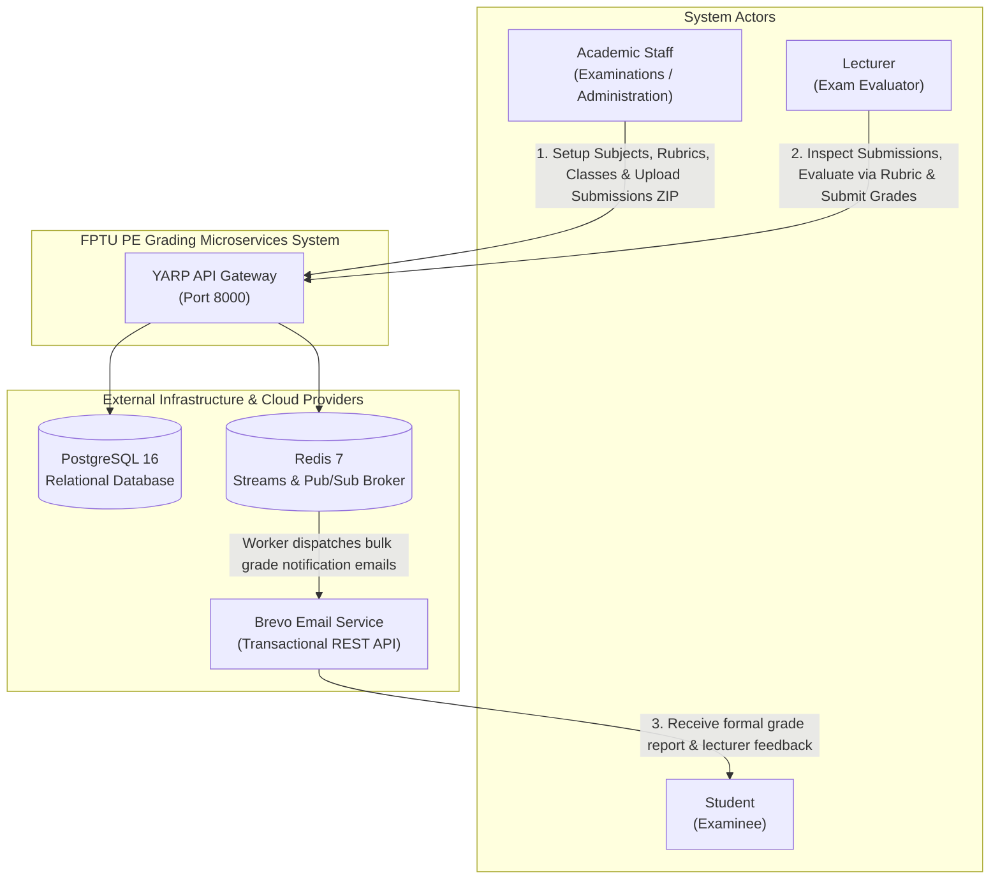
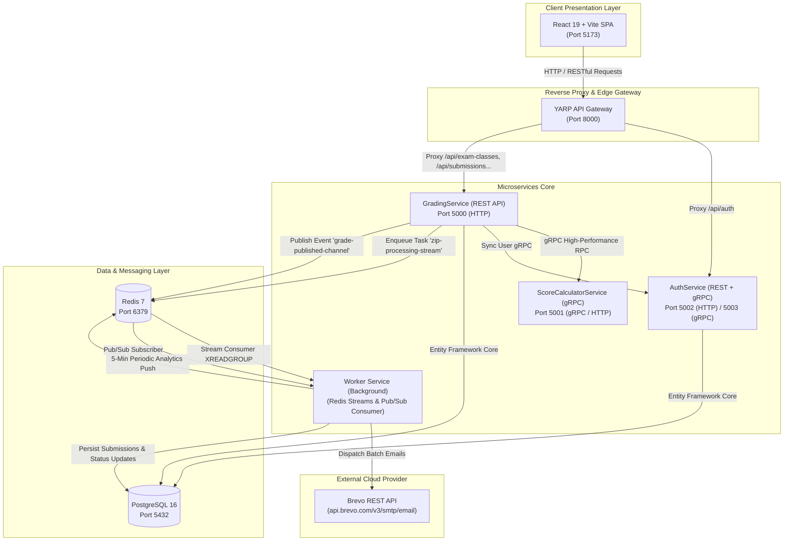
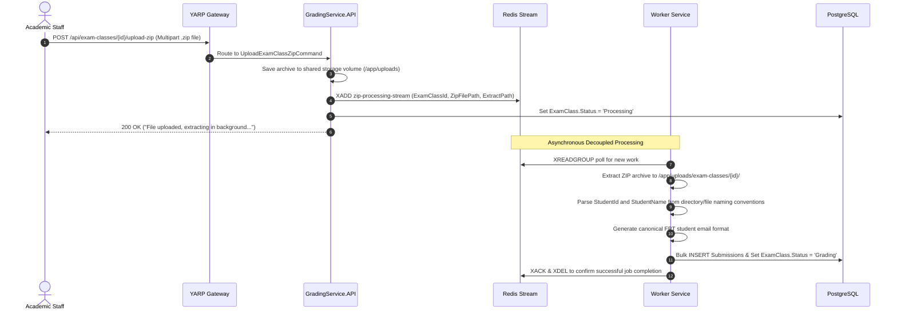
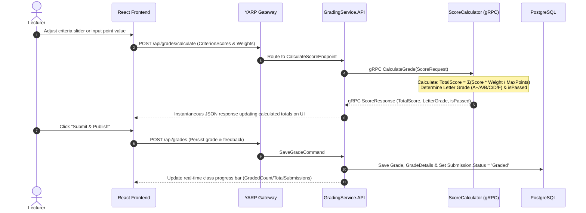
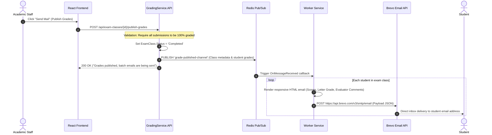

# 🎓 FPTU PE Grading Microservices System
> **Automated Practical Exam (PE) Grading, Analytics & Notification Platform for FPT University**  
> *Developed for PRN232 – Distributed Applications & Microservices Architecture (.NET 8)*

[](https://dotnet.microsoft.com/)
[](https://www.docker.com/)
[](https://react.dev/)
[](https://grpc.io/)
[](https://redis.io/)
[](https://www.postgresql.org/)
[](https://www.brevo.com/)

---

## 📺 Video Demonstrations

> *This section contains 3 detailed demonstration videos covering each operational phase and business scenario of the system:*

### 🎥 Demo Video 1: Academic Staff Exam Administration & Asynchronous Processing
* **Highlights:** Academic Staff authentication, subject management (`Subject`), multi-criteria grading rubric configuration (`Rubric Criteria`), exam class scheduling, and batch submission ZIP file upload with non-blocking extraction powered by **Redis Streams**.
* **Video URL:** *[👉 PASTE DEMO VIDEO 1 LINK HERE (YouTube / Google Drive)]()*
<!-- Video 1 Placeholder -->
```
[VIDEO 1 PLACEHOLDER: Academic Staff Setup, Rubric Management & Redis Streams Extraction]
```

---

### 🎥 Demo Video 2: Lecturer Grading & High-Performance gRPC Score Calculation
* **Highlights:** Lecturer login, real-time dynamic progress monitoring ($0/N$), split-screen submission inspection, interactive rubric grading, and sub-millisecond weighted score calculation with automatic letter grade conversion via **gRPC Microservice**.
* **Video URL:** *[👉 PASTE DEMO VIDEO 2 LINK HERE (YouTube / Google Drive)]()*
<!-- Video 2 Placeholder -->
```
[VIDEO 2 PLACEHOLDER: Lecturer Grading & gRPC Score Calculation Engine]
```

---

### 🎥 Demo Video 3: Grade Analytics, Excel Export & Batch Transactional Email Dispatch
* **Highlights:** Class grade distribution analytics (GPA, Pass/Fail ratios, grade charts), standardized FPT University grade sheet export (`EPPlus .xlsx`), and automated batch student notification via **Brevo Transactional Email REST API**.
* **Video URL:** *[👉 PASTE DEMO VIDEO 3 LINK HERE (YouTube / Google Drive)]()*
<!-- Video 3 Placeholder -->
```
[VIDEO 3 PLACEHOLDER: Analytics, Excel Report Generation & Brevo Email Dispatch]
```

---

## 🏛️ 1. System Context View

### 1.1 Business Context & Problem Statement
At FPT University, Practical Exams (PE) for non-programming or text-heavy subjects (such as Academic Writing, Business Communication, Project Management, and Entrepreneurship) require students to submit written documents packaged in compressed `.zip` archives. 

Under the traditional grading workflow, lecturers endure a tedious and error-prone process:
* **The "Alt-Tab" Bottleneck:** Lecturers must constantly toggle between 4 separate application windows (Submission Document $\leftrightarrow$ PDF Rubric Guide $\leftrightarrow$ Master Excel Grade Template $\leftrightarrow$ Email Client).
* **Manual Arithmetic Errors:** Manually summing weighted criteria scores often leads to calculation discrepancies, especially under tight grading deadlines.
* **Student Identity Confusion:** Managing hundreds of local files increases the risk of recording a score against the wrong student ID.

**FPTU PE Grading System** addresses these pain points through a unified, cloud-native distributed architecture:
1. **Asynchronous Archive Extraction:** Uploaded `.zip` archives are unpacked in the background using **Redis Streams**, extracting student metadata and generating official FPT University email addresses.
2. **Single-Screen Grading Workspace:** A unified interface featuring document preview alongside interactive rubric sliders.
3. **Automated Arithmetic via gRPC:** Total scores, letter grades, and pass/fail statuses are computed instantly by an isolated calculation microservice.
4. **Standardized Reporting & Automated Outreach:** One-click Excel grade report generation matching official university formats, accompanied by bulk email delivery via Brevo API upon grade publication.

### 1.2 System Context Diagram



---

## ⚙️ 2. Runtime Architecture & Microservices

The application is engineered on the **.NET 8** ecosystem following modern distributed systems best practices:



### 2.1 Service Catalog

| Service Name | Technology Stack | Internal Port | Host Port | Primary Responsibilities |
| :--- | :--- | :---: | :---: | :--- |
| **YARP Gateway** | .NET 8 / YARP | 8080 | **8000** | Centralized API entry point, route dispatching, CORS handling, rate limiting. |
| **AuthService** | .NET 8 / EF Core | 8080, 8081 | **5002, 5003** | User authentication, JWT issuance, role management (`AcademicStaff` / `Lecturer`), gRPC identity synchronization. |
| **GradingService** | .NET 8 / MediatR / CQRS | 8080 | **5000** | Core business domain: Course catalog, exam scheduling, rubric criteria, Excel grade sheet export via EPPlus. |
| **ScoreCalculator** | .NET 8 / gRPC | 8080 | **5001** | High-speed arithmetic engine: Weighted criteria score computation, letter grade mapping (A+/A/B/C/D/F), pass/fail evaluation. |
| **Worker Service** | .NET 8 / BackgroundService | - | - | Asynchronous consumer: Background ZIP extraction via Redis Streams, periodic 5-minute analytics generation, transactional email dispatch via Brevo. |
| **PostgreSQL 16** | Postgres Alpine | 5432 | **5432** | Primary ACID-compliant relational data store. |
| **Redis 7** | Redis Alpine | 6379 | **6379** | High-performance message broker supporting durable FIFO Streams and low-latency Pub/Sub channels. |
| **Frontend Web** | React 19 / Vite | 5173 | **5173** | Modern Single Page Application (100% English, responsive layout, real-time dynamic progress tracking). |

---

## 🔄 3. Communication Matrix & Technical Workflows

### 3.1 Inter-Service Communication Matrix

| Source Service | Target Service | Protocol / Transport | Purpose |
| :--- | :--- | :--- | :--- |
| **Frontend Web** | **YARP Gateway** | HTTP/1.1 REST (`Bearer JWT`) | All client interactions and state mutations. |
| **YARP Gateway** | **Auth / Grading API** | HTTP/1.1 Reverse Proxy | Route matching and request forwarding. |
| **GradingService** | **ScoreCalculator** | **gRPC (HTTP/2 + Protobuf)** | Sub-millisecond arithmetic score calculation and letter grade mapping. |
| **GradingService** | **AuthService** | **gRPC (HTTP/2)** | Verify and synchronize lecturer profiles during class scheduling. |
| **GradingService** | **Redis (Stream)** | RESP3 (`XADD`) | Enqueue compute-heavy ZIP extraction jobs (`zip-processing-stream`). |
| **Worker Service** | **Redis (Stream)** | RESP3 (`XREADGROUP` / `XACK`) | Durable consumer group processing with guaranteed at-least-once delivery. |
| **GradingService** | **Redis (Pub/Sub)** | RESP3 (`PUBLISH`) | Broadcast class grade publication events (`grade-published-channel`). |
| **Worker Service** | **Brevo REST API** | HTTPS REST (`api-key`) | Deliver batch transactional emails to students. |

---

### 3.2 Workflow 1: Asynchronous ZIP Upload & Background Extraction (Redis Stream)



---

### 3.3 Workflow 2: Interactive Rubric Evaluation with gRPC Calculator



---

### 3.4 Workflow 3: Bulk Grade Publication & Transactional Email Dispatch



---

## 🐳 4. Deployment View (Docker Containerization)

The entire microservices topology is orchestrated through **Docker Compose** on an isolated bridge network:

```
+-----------------------------------------------------------------------------------+
|                            Docker Host (grading-network)                          |
|                                                                                   |
|  [Port 8000] ------> grading-gateway (YARP Reverse Proxy)                         |
|                           |                                                       |
|           +---------------+---------------+                                       |
|           |                               |                                       |
|  [Port 5002/5003]                 [Port 5000]                                     |
|  grading-auth-api (AuthService)   grading-api (GradingService)                    |
|           |                               |                                       |
|           |                               +----------> grading-score-calc [5001]  |
|           |                               |            (gRPC Calculator)          |
|           |                               |                                       |
|           +-----------------------+-------+                                       |
|                                   |                                               |
|                    +--------------+--------------+                                |
|                    |                             |                                |
|           [Port 5432]                       [Port 6379]                           |
|           grading-postgres                  grading-redis                         |
|           (PostgreSQL 16)                   (Redis 7 Stream/PubSub)               |
|                    |                             |                                |
|                    |                             v                                |
|                    +-------------------> grading-worker                           |
|                                          (Background Queue & Brevo Consumer)      |
|                                                  |                                |
|                                                  v                                |
|                                            [Internet] ---> Brevo Email API        |
+-----------------------------------------------------------------------------------+
|  Volumes:                                                                         |
|    - postgres-data: /var/lib/postgresql/data (Persistent database storage)        |
|    - uploads-data:  /app/uploads (Shared submission archives & extracted files)   |
+-----------------------------------------------------------------------------------+
```

### 4.1 Port Mapping & Service Dependencies

| Container Name | Service Image | Host Port | Container Port | Dependencies |
| :--- | :--- | :---: | :---: | :--- |
| `grading-gateway` | `be-gateway` | **8000** | 8080 | `auth-api`, `api` |
| `grading-auth-api` | `be-auth-api` | **5002, 5003** | 8080, 8081 | `postgres` |
| `grading-api` | `be-api` | **5000** | 8080 | `postgres`, `redis`, `score-calculator-service` |
| `grading-score-calculator-service` | `be-score-calculator` | **5001** | 8080 | None |
| `grading-worker` | `be-worker` | - | - | `postgres`, `redis` |
| `grading-postgres` | `postgres:16-alpine` | **5432** | 5432 | None |
| `grading-redis` | `redis:7-alpine` | **6379** | 6379 | None |

---

## 🚀 5. Quick Start Guide

### 📋 Prerequisites
1. **Docker Desktop** installed and running.
2. **Node.js** (v18.x or v20.x LTS).
3. **Git**.

---

### 🔹 Step 1: Clone the Repository
```bash
git clone https://github.com/NguyenDuyKhoii/GradingSystem.git
cd GradingSystem
```

---

### 🔹 Step 2: Configure Environment Variables (`be/.env`)
Create a `.env` file inside the `be` directory (or duplicate from `.env.example`):
```env
# Brevo Email Configuration
BREVO_API_KEY=your_brevo_api_key_here
BREVO_SENDER_EMAIL=khoind1235@gmail.com
```

---

### 🔹 Step 3: Launch Microservices via Docker Compose
Open a terminal in the `be` folder:
```bash
cd be
docker compose up -d --build
```
> ⏱️ *The initial build takes approximately 1-2 minutes. Verify that all 7 containers are active with `docker ps`.*

---

### 🔹 Step 4: Launch the Frontend Web Application
Open a new terminal window in the `fe` directory:
```bash
cd fe
npm install
npm run dev
```
Navigate to **`http://localhost:5173`** in your browser.

---

### 🔑 Step 5: Default Seed Accounts

| Role | Username | Password | Full Name | Demo Purpose |
| :--- | :--- | :---: | :--- | :--- |
| **Academic Staff** | `academic` | `12345` | **Academic Staff** | Manage subjects, configure rubrics, schedule exam classes, upload ZIP submissions, export Excel reports, dispatch bulk emails. |
| **Lecturer** | `lecturer1` | `12345` | **ThS. Nguyễn Duy Khôi** | View assigned exam classes, inspect student submissions, grade via interactive rubrics with live gRPC score calculation. |
| **Lecturer** | `lecturer2` | `12345` | **TS. Lê Hoàng Nam** | Evaluator account for concurrent grading scenarios. |
| **Lecturer** | `lecturer3` | `12345` | **TS. Trần Trọng Bình** | Evaluator account. |
| **Lecturer** | `lecturer4` | `12345` | **ThS. Huỳnh Tuấn Anh** | Evaluator account. |
| **Lecturer** | `lecturer5` | `12345` | **TS. Kiều Trọng Khánh** | Evaluator account. |

---

## 📂 6. Project Directory Structure

```
GradingSystem2/
├── be/                                      # Microservices Backend (.NET 8)
│   ├── docker-compose.yml                   # Docker Compose orchestrating 7 containers
│   ├── .env.example                         # Environment template for Brevo Email configuration
│   ├── FptuGradingSystem.Gateway/           # YARP Reverse Proxy & Edge Gateway
│   ├── FptuGradingSystem.AuthService/       # Authentication API (JWT + gRPC Identity Sync)
│   ├── FptuGradingSystem.GradingService/    # Core Grading Service (Clean Architecture / CQRS)
│   │   ├── FptuGradingSystem.API/           # RESTful Controllers (Kebab-case routing)
│   │   ├── FptuGradingSystem.Application/   # MediatR Commands, Queries, Validators, DTOs
│   │   ├── FptuGradingSystem.Domain/        # Core Business Entities (ExamClass, Submission, Grade...)
│   │   └── FptuGradingSystem.Infrastructure/# EF Core DbContext, PostgreSQL Migrations
│   ├── FptuGradingSystem.ScoreCalculatorService/ # gRPC Service Engine (.proto contract)
│   └── FptuGradingSystem.Worker/            # Background Worker (Redis Streams, Pub/Sub, Brevo API)
├── fe/                                      # Frontend Client (React 19 + Vite)
│   ├── src/
│   │   ├── components/
│   │   │   ├── AcademicDashboard.jsx        # Academic Staff Portal (Subjects, Rubrics, Classes, Analytics)
│   │   │   ├── LecturerDashboard.jsx        # Lecturer Portal (Real-time Progress 0/N, Submissions List)
│   │   │   ├── GradingView.jsx              # Split-screen Grading Workspace & gRPC Live Calculation
│   │   │   └── Login.jsx                    # JWT Authentication Component
│   │   ├── services/api.js                  # Axios Interceptor with Bearer Token Injection
│   │   └── index.css                        # Modern Glassmorphic UI Stylesheet
├── test-data/                               # Seed Submissions Archive for Demonstration
│   └── SE1801_Submissions.zip               # Sample ZIP containing 5 student submissions
└── README.md                                # System Architecture & Deployment Documentation
```

---

## 📋 7. PRN232 Course Assessment Requirement Mapping

| Mandatory Requirement | Architectural Implementation | Source Code Reference |
| :--- | :--- | :--- |
| **1. REST API Service** | ASP.NET Core 8 Web API with standardized kebab-case endpoints, dynamic pagination, multi-field sorting, filtering, and JWT authentication. | `GradingService.API/Controllers/`, `AuthService.API/` |
| **2. Background Job** | Dedicated Worker Service running periodic 5-minute analytics generation and asynchronous batch email processing. | `Worker/GradeReportWorker.cs`, `Worker/Services/BrevoEmailService.cs` |
| **3. Message Broker** | Redis Streams (durable FIFO queue for ZIP archive processing) & Redis Pub/Sub (real-time publication broadcast). | `GradingService.Application/Common/Interfaces/IZipProcessingQueue.cs`, `Worker/Worker.cs` |
| **4. gRPC Service** | High-performance calculation microservice utilizing HTTP/2 and Protocol Buffers for dynamic score computation. | `ScoreCalculatorService/Protos/grade_calculator.proto`, `GradingCalcService.cs` |
| **5. Containerization** | Multi-container Docker Compose deployment managing 7 independent containers, shared volumes, and private networks. | `be/docker-compose.yml` |
| **6. Clean Architecture** | Strict separation of concerns: Domain $\rightarrow$ Application (CQRS with MediatR) $\rightarrow$ Infrastructure $\rightarrow$ Presentation API. | `FptuGradingSystem.GradingService/` |