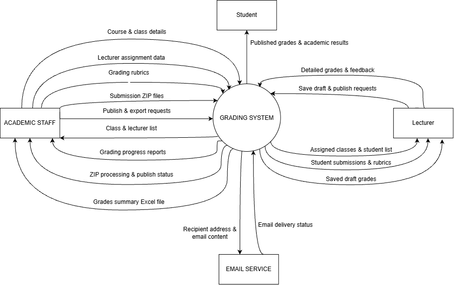
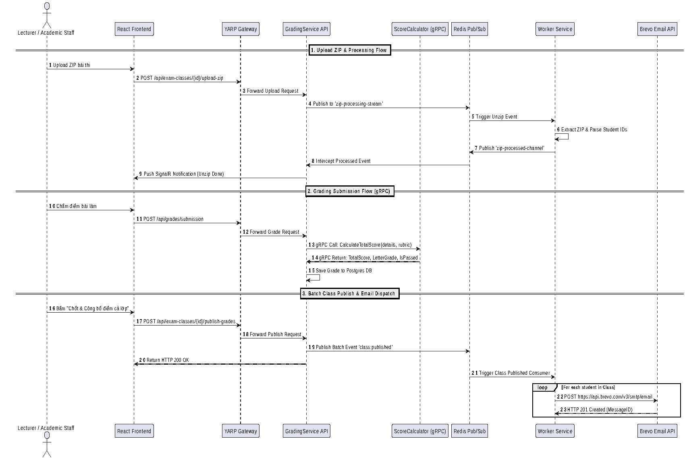
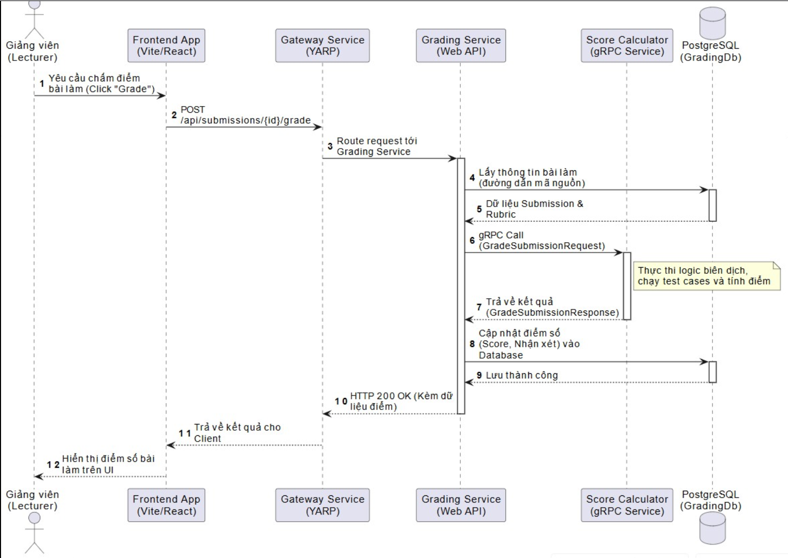
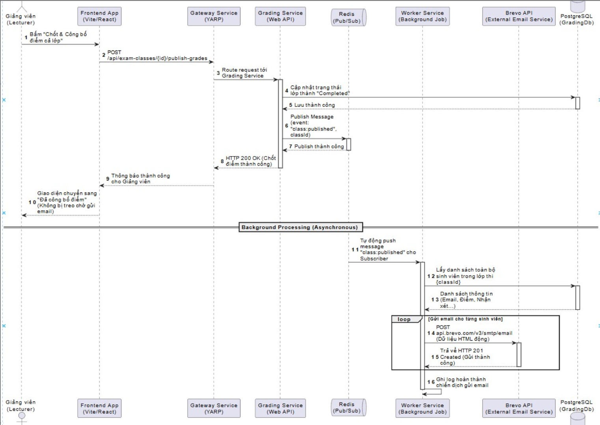
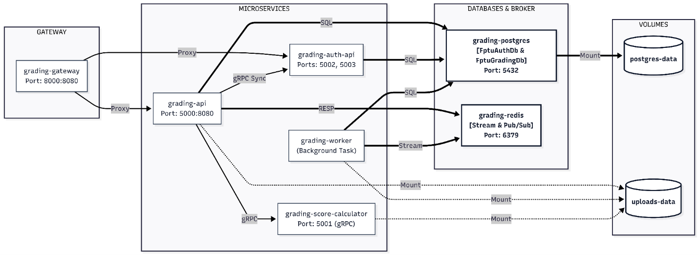

# 🎓 FPTU PE Grading Microservices System
> **Automated Practical Exam (PE) Grading, Analytics & Notification Platform for FPT University**  
> *Developed for PRN232 – Distributed Applications & Microservices Architecture (.NET 8)*

[](https://dotnet.microsoft.com/)
[](https://www.docker.com/)
[](https://react.dev/)
[](https://grpc.io/)
[](https://redis.io/)
[](https://www.postgresql.org/)
[](https://www.brevo.com/)

---

## 🏛️ 1. System Context View

### 1.1 Business Context & Problem Statement
At FPT University, Practical Exams (PE) for essay and project-based subjects (e.g., Project Management, Academic Writing) traditionally rely on tedious manual workflows: downloading `.zip` submissions, toggling across 4 separate windows (Word/PDF $\leftrightarrow$ Rubric $\leftrightarrow$ Excel $\leftrightarrow$ Email), and manually computing weighted scores—leading to calculation errors and operational bottlenecks.

**FPTU PE Grading System** streamlines this workflow through a unified microservices platform:
* **Asynchronous ZIP Ingestion:** Background submission extraction and student metadata parsing powered by **Redis Streams**.
* **Unified Grading Workspace:** Single-screen document preview paired with sub-millisecond weighted score calculation via **gRPC**.
* **Automated Reporting & Delivery:** One-click official university Excel grade sheet export and batch notification via **Brevo Email API**.

### 1.2 System Context Diagram
The diagram below defines the system boundary, participating actors, and external services:



* **Primary Actors:**
  * **Academic Staff:** Manages courses, rubrics, and exam classes; uploads submission ZIPs; exports reports and publishes grades.
  * **Lecturer:** Evaluates assigned student submissions using interactive rubrics with real-time progress tracking.
  * **Student:** Receives official grade reports and feedback directly via university email.
* **External Systems:**
  * **Brevo Email API:** Transactional email gateway for bulk grade notification delivery.
  * **PostgreSQL:** Relational database cluster hosting `FptuAuthDb` and `FptuGradingDb`.
  * **Redis 7:** Distributed message broker for durable Stream processing and Pub/Sub event channels.

---

## 📺 Video Demonstrations

> *This section is reserved for the 3 official walkthrough videos demonstrating all core capabilities and end-to-end workflows of the system:*

### 🎥 Demo Video 1: Academic Staff Administration & Asynchronous Processing
* **Highlights:** Academic Staff login, subject catalog management, multi-criteria rubric configuration, exam class scheduling, and non-blocking ZIP archive extraction powered by **Redis Streams**.
* **Video URL:** *[👉 PASTE DEMO VIDEO 1 LINK HERE (YouTube / Google Drive)]()*
```
[VIDEO 1 PLACEHOLDER: Academic Staff Setup, Rubric Management & Redis Streams Extraction]
```

---

### 🎥 Demo Video 2: Lecturer Grading Workspace & Live gRPC Calculation
* **Highlights:** Lecturer authentication, real-time dynamic progress monitoring ($0/N$), split-screen document preview, interactive criteria evaluation, and sub-millisecond weighted score calculation with automatic letter grade conversion via **gRPC Microservice**.
* **Video URL:** *[👉 PASTE DEMO VIDEO 2 LINK HERE (YouTube / Google Drive)]()*
```
[VIDEO 2 PLACEHOLDER: Lecturer Grading & gRPC Score Calculation Engine]
```

---

### 🎥 Demo Video 3: Grade Analytics, Excel Export & Batch Email Dispatch
* **Highlights:** Class grade distribution charts (GPA, pass/fail ratios), official FPT University grade sheet export (`EPPlus .xlsx`), and automated batch student notification via **Brevo Transactional Email REST API**.
* **Video URL:** *[👉 PASTE DEMO VIDEO 3 LINK HERE (YouTube / Google Drive)]()*
```
[VIDEO 3 PLACEHOLDER: Analytics, Excel Report Generation & Brevo Email Dispatch]
```

---

## ⚙️ 2. Runtime Architecture View

The system follows a modern **Distributed Microservices Architecture** on the .NET 8 ecosystem, with a centralized API Gateway serving as the single entry point for all client requests.

### 2.1 Service Catalog

| Service Name | Technology Stack | Host Port | Internal Port | Primary Responsibilities |
| :--- | :--- | :---: | :---: | :--- |
| **Gateway Service** | .NET 8 / YARP Reverse Proxy | **8000** | 8080 | Single entry point, routing, reverse proxying, CORS management, and WebSocket proxying. |
| **Auth Service** | .NET 8 / EF Core | **5002, 5003** | 8080, 8081 | Identity Provider: User management, authentication, role-based authorization (`AcademicStaff`, `Lecturer`), JWT token issuance, and gRPC user synchronization. |
| **Grading Service** | .NET 8 / MediatR / CQRS | **5000** | 8080 | Core domain: Exam classes, student submissions, rubric criteria, Excel grade report generation (EPPlus), and grade publication. |
| **Score Calculator Service** | .NET 8 / gRPC (HTTP/2) | **5001** | 8080 | High-performance calculation engine: Reading submission files, computing weighted scores, evaluating Pass/Fail, and letter grade conversion. |
| **Worker Service** | .NET 8 / BackgroundService | - | - | Background task processing: Decompressing ZIP archives via Redis Streams, generating periodic 5-minute analytics reports, and sending emails via Brevo API. |
| **PostgreSQL Database** | PostgreSQL 16 Alpine | **5432** | 5432 | Relational storage for application data across `FptuAuthDb` and `FptuGradingDb`. |
| **Redis Broker & Cache** | Redis 7 Alpine | **6379** | 6379 | In-memory message broker managing durable Streams (FIFO) and Pub/Sub event channels. |
| **Frontend Application** | React 19 / Vite | **5173** | 5173 | Responsive Single Page Application (100% English, real-time dynamic progress tracking, glassmorphic UI). |

---

## 🔄 3. Communication & Sequence Workflows

### 3.1 Inter-Service Communication Matrix

| Source Service | Target Service | Protocol / Transport | Purpose |
| :--- | :--- | :--- | :--- |
| **Frontend Web** | **YARP Gateway** | HTTP/1.1 REST (`Bearer JWT`) | All client interactions and state mutations. |
| **YARP Gateway** | **Auth / Grading API** | HTTP/1.1 Reverse Proxy | Route matching and request forwarding. |
| **GradingService** | **ScoreCalculator** | **gRPC (HTTP/2 + Protobuf)** | Sub-millisecond arithmetic score calculation and letter grade mapping. |
| **GradingService** | **AuthService** | **gRPC (HTTP/2)** | Verify and synchronize lecturer profiles during class scheduling. |
| **GradingService** | **Redis (Stream)** | RESP3 (`XADD`) | Enqueue compute-heavy ZIP extraction jobs (`zip-processing-stream`). |
| **Worker Service** | **Redis (Stream)** | RESP3 (`XREADGROUP` / `XACK`) | Durable consumer group processing with guaranteed at-least-once delivery. |
| **GradingService** | **Redis (Pub/Sub)** | RESP3 (`PUBLISH`) | Broadcast class grade publication events (`grade-published-channel`). |
| **Worker Service** | **Brevo REST API** | HTTPS REST (`api-key`) | Deliver batch transactional emails to students. |

---

### 3.2 Core Sequence Workflows

#### Workflow A: End-to-End Submission Evaluation & Grade Publication
The diagram below illustrates the end-to-end operational lifecycle: from ZIP archive upload and background Redis Stream decompression to live gRPC score evaluation, final grade publication, and Brevo email notification:



#### Workflow B: Interactive Rubric Evaluation with gRPC Calculator
Demonstrates the real-time interaction between the frontend, Grading Service, and isolated gRPC Score Calculator:



#### Workflow C: Batch Grade Publication & Email Dispatch
Illustrates how publishing an exam class triggers asynchronous event broadcasting via Redis Pub/Sub to dispatch official grade notifications:



---

## 🐳 4. Deployment View (Docker Architecture)

The entire backend infrastructure is containerized and orchestrated via **Docker Compose**, running within an isolated bridge network (`grading-network`):



### 4.1 Container Topology & Port Mapping

| Container Name | Service Image | Host Port | Container Port | Purpose / Protocol |
| :--- | :--- | :---: | :---: | :--- |
| `grading-gateway` | `be-gateway` | **8000** | 8080 | Single entry point for frontend HTTP & WebSocket traffic. |
| `grading-auth-api` | `be-auth-api` | **5002, 5003** | 8080, 8081 | REST Auth API (5002) & gRPC User Sync Service (5003). |
| `grading-api` | `be-api` | **5000** | 8080 | Core RESTful Grading API & SignalR hub. |
| `grading-score-calculator-service` | `be-score-calculator` | **5001** | 8080 | gRPC Score Calculation Engine (HTTP/2). |
| `grading-worker` | `be-worker` | - | - | Background task processor (Redis Streams, Pub/Sub, Brevo API). |
| `grading-postgres` | `postgres:16-alpine` | **5432** | 5432 | Relational database (`FptuGradingDb` & `FptuAuthDb`). |
| `grading-redis` | `redis:7-alpine` | **6379** | 6379 | Message broker & distributed cache. |

### 4.2 Shared Storage Volumes
* **`postgres-data`** (`/var/lib/postgresql/data`): Persistent storage volume for PostgreSQL databases.
* **`uploads-data`** (`/app/uploads`): Shared named volume mounted across `grading-api`, `grading-worker`, and `grading-score-calculator-service` for synchronized ZIP archives and extracted student files.

