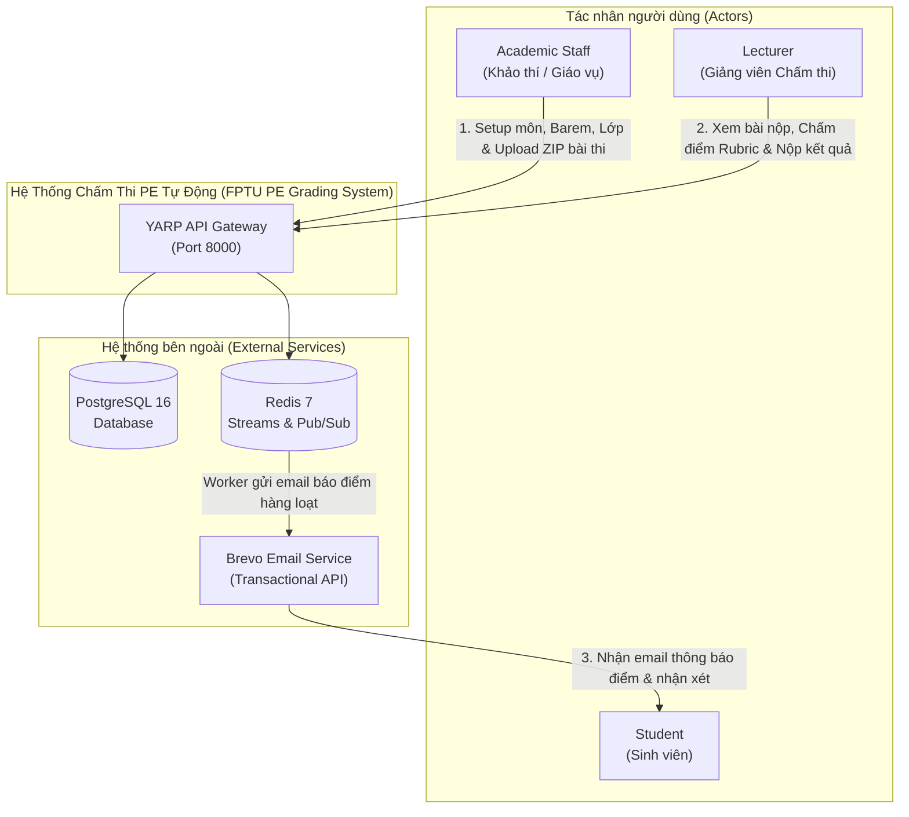
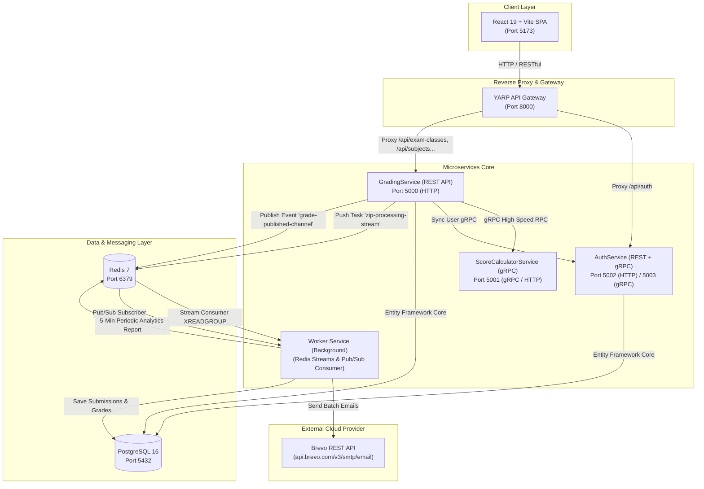
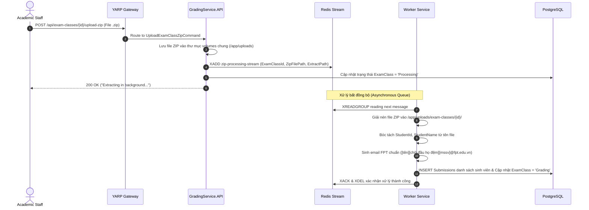
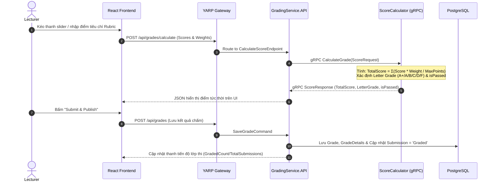
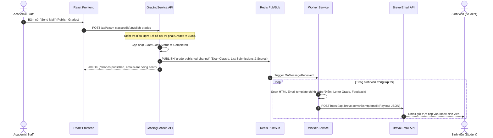

# 🎓 FPTU PE Grading Microservices System
> **Automated Practical Exam (PE) Grading & Analytics Platform for FPT University**  
> *Developed for PRN232 – Distributed Applications & Microservices Architecture (.NET 8)*

[](https://dotnet.microsoft.com/)
[](https://www.docker.com/)
[](https://react.dev/)
[](https://grpc.io/)
[](https://redis.io/)
[](https://www.postgresql.org/)
[](https://www.brevo.com/)

---

## 📺 Demonstration Videos (Khu vực Video Demo)

> *Dưới đây là 3 video demo từng phân hệ và kịch bản thực tế của hệ thống:*

### 🎥 Video Demo 1: Academic Staff Management (Quản lý Kỳ thi & Xếp lớp)
* **Nội dung:** Đăng nhập Khảo thí, quản lý danh mục môn học (`Subject`), tạo Barem điểm đa tiêu chí (`Rubric Criteria`), xếp lịch thi và tải lên file ZIP bài nộp sinh viên (`Redis Streams Asynchronous Extraction`).
* **Link Video:** *[👉 DÁN LINK VIDEO DEMO 1 VÀO ĐÂY (YouTube / Google Drive)]()*
<!-- Placeholder Video 1 -->
```
[VIDEO 1 PLACEHOLDER: Academic Staff Setup & ZIP Extraction]
```

---

### 🎥 Video Demo 2: Lecturer Grading & gRPC Calculation (Chấm thi & Tính điểm Real-time)
* **Nội dung:** Giảng viên đăng nhập, theo dõi thanh tiến độ thực tế $0/N$, xem trực tiếp nội dung bài nộp sinh viên, chấm điểm qua Rubric tương tác với **gRPC Microservice** tự động tính tổng điểm và quy đổi letter grade tức thì.
* **Link Video:** *[👉 DÁN LINK VIDEO DEMO 2 VÀO ĐÂY (YouTube / Google Drive)]()*
<!-- Placeholder Video 2 -->
```
[VIDEO 2 PLACEHOLDER: Lecturer Grading & gRPC Score Calculation]
```

---

### 🎥 Video Demo 3: Analytics, Excel Export & Batch Email Dispatch (Công bố & Báo cáo)
* **Nội dung:** Xem biểu đồ phân tích phổ điểm (Grade Analytics & Distribution), xuất bảng điểm Excel chuẩn mẫu Đại học FPT (`EPPlus`), và kích hoạt gửi email thông báo điểm đồng loạt qua **Brevo Transactional Email API**.
* **Link Video:** *[👉 DÁN LINK VIDEO DEMO 3 VÀO ĐÂY (YouTube / Google Drive)]()*
<!-- Placeholder Video 3 -->
```
[VIDEO 3 PLACEHOLDER: Analytics, Excel Export & Brevo Email Dispatch]
```

---

## 🏛️ 1. System Context View (Bối Cảnh Hệ Thống)

### 1.1 Vấn đề nghiệp vụ (Problem Statement)
Tại Đại học FPT, các kỳ thi thực hành tự luận / báo cáo (Practical Exam - Writing, Project Management, Business Plan...) yêu cầu sinh viên nộp file tài liệu nén (`.zip`). Quy trình truyền thống buộc giảng viên phải liên tục **Alt-Tab giữa 4 cửa sổ** (Word/Excel bài nộp $\leftrightarrow$ PDF Rubric $\leftrightarrow$ File Excel điểm $\leftrightarrow$ Email), gây mất tập trung, dễ nhầm lẫn sinh viên và tính sai tổng điểm số học.

**FPTU PE Grading System** giải quyết triệt để vấn đề này bằng nền tảng web tập trung:
* Tự động giải nén ngầm bằng **Message Broker (Redis Streams)**.
* Giao diện chia đôi màn hình: Xem bài nộp bên trái + Barem điểm tương tác bên phải.
* Tự động tính điểm và xếp loại học lực qua **gRPC Service**.
* Xuất báo cáo Excel FPT chuẩn hóa và gửi email điểm thi chính thức tự động tới hòm thư sinh viên.

### 1.2 System Context Diagram (Sơ đồ ngữ cảnh)



---

## ⚙️ 2. Runtime Architecture & Microservices (Kiến Trúc Thời Gian Chạy)

Hệ thống được thiết kế theo kiến trúc **Distributed Microservices** trên nền tảng .NET 8:



### 2.1 Bảng Danh Mục Dịch Vụ (Service Catalog)

| Tên Dịch Vụ (Service) | Công Nghệ | Port Nội Bộ | Port Host | Trách Nhiệm Chính |
| :--- | :--- | :---: | :---: | :--- |
| **YARP Gateway** | .NET 8 / YARP | 8080 | **8000** | Cổng giao tiếp tập trung, định tuyến (Routing), CORS, cân bằng tải. |
| **AuthService** | .NET 8 / EF Core | 8080, 8081 | **5002, 5003** | Xác thực JWT, cấp quyền `AcademicStaff` / `Lecturer`, gRPC User Sync. |
| **GradingService** | .NET 8 / MediatR / CQRS | 8080 | **5000** | Nghiệp vụ cốt lõi: Quản lý môn học, lớp thi, barem điểm, xuất file Excel EPPlus. |
| **ScoreCalculator** | .NET 8 / gRPC | 8080 | **5001** | Engine số học: Tính tổng điểm có trọng số, quy đổi thang điểm chữ (A+/A/B/C/D/F), xác định Pass/Fail. |
| **Worker Service** | .NET 8 / BackgroundService | - | - | Consumer ngầm: Giải nén file ZIP qua Redis Stream, gửi email qua Brevo API, phát báo cáo 5 phút qua Pub/Sub. |
| **PostgreSQL 16** | Postgres Alpine | 5432 | **5432** | Cơ sở dữ liệu quan hệ lưu trữ dữ liệu ACID của hệ thống. |
| **Redis 7** | Redis Alpine | 6379 | **6379** | Message Broker: Hỗ trợ hàng đợi Stream (FIFO bền vững) và kênh Pub/Sub thời gian thực. |
| **Frontend Web** | React 19 / Vite | 5173 | **5173** | Giao diện Single Page Application (100% English, Responsive, Real-time progress). |

---

## 🔄 3. Communication Matrix & Technical Workflows (Ma Trận Giao Tiếp & Quy Trình Kỹ Thuật)

### 3.1 Ma trận giao tiếp liên dịch vụ (Communication Matrix)

| Nguồn (Source) | Đích (Destination) | Giao Thức (Protocol) | Mục Đích (Purpose) |
| :--- | :--- | :--- | :--- |
| **Frontend Web** | **YARP Gateway** | HTTP/1.1 REST | Truyền tải tất cả các thao tác của người dùng (`Bearer JWT`). |
| **YARP Gateway** | **Auth / Grading API** | HTTP/1.1 Reverse Proxy | Định tuyến request tới service tương ứng. |
| **GradingService** | **ScoreCalculator** | **gRPC (HTTP/2 + Protobuf)** | Tính toán điểm thành phần theo Rubric với độ trễ cực thấp (< 5ms). |
| **GradingService** | **AuthService** | **gRPC (HTTP/2)** | Kiểm tra và đồng bộ thông tin Giảng viên khi phân công lớp thi. |
| **GradingService** | **Redis (Stream)** | RESP3 (`XADD`) | Đẩy tác vụ giải nén file ZIP dung lượng lớn (`zip-processing-stream`). |
| **Worker Service** | **Redis (Stream)** | RESP3 (`XREADGROUP` / `XACK`) | Worker đọc và xác nhận đã xử lý xong tin nhắn trong hàng đợi FIFO. |
| **GradingService** | **Redis (Pub/Sub)** | RESP3 (`PUBLISH`) | Phát sự kiện công bố điểm cả lớp (`grade-published-channel`). |
| **Worker Service** | **Brevo REST API** | HTTPS REST (`api-key`) | Gửi email hàng loạt thông báo kết quả thi tới hòm thư sinh viên. |

---

### 3.2 Quy trình 1: Tải lên và Giải nén file ZIP ngầm (Redis Stream)



---

### 3.3 Quy trình 2: Giảng viên chấm bài với gRPC Score Calculator



---

### 3.4 Quy trình 3: Công bố điểm & Gửi Email hàng loạt qua Brevo API



---

## 🐳 4. Deployment View (Kiến Trúc Triển Khai Docker)

Toàn bộ hệ thống được container hóa và điều phối bằng một lệnh duy nhất thông qua **Docker Compose**:

```
+-----------------------------------------------------------------------------------+
|                            Docker Host (grading-network)                          |
|                                                                                   |
|  [Port 8000] ------> grading-gateway (YARP Reverse Proxy)                         |
|                           |                                                       |
|           +---------------+---------------+                                       |
|           |                               |                                       |
|  [Port 5002/5003]                 [Port 5000]                                     |
|  grading-auth-api (AuthService)   grading-api (GradingService)                    |
|           |                               |                                       |
|           |                               +----------> grading-score-calc [5001]  |
|           |                               |            (gRPC Calculator)          |
|           |                               |                                       |
|           +-----------------------+-------+                                       |
|                                   |                                               |
|                    +--------------+--------------+                                |
|                    |                             |                                |
|           [Port 5432]                       [Port 6379]                           |
|           grading-postgres                  grading-redis                         |
|           (PostgreSQL 16)                   (Redis 7 Stream/PubSub)               |
|                    |                             |                                |
|                    |                             v                                |
|                    +-------------------> grading-worker                           |
|                                          (Background Queue & Brevo Consumer)      |
|                                                  |                                |
|                                                  v                                |
|                                            [Internet] ---> Brevo Email API        |
+-----------------------------------------------------------------------------------+
|  Volumes:                                                                         |
|    - postgres-data: /var/lib/postgresql/data (Persistent DB storage)              |
|    - uploads-data:  /app/uploads (Shared ZIP and submission storage)              |
+-----------------------------------------------------------------------------------+
```

### 4.1 Bảng Mapping Cổng & Phụ Thuộc (Port Mapping & Dependencies)

| Container Name | Service Image | Cổng Host (Exposed) | Cổng Container | Phụ thuộc (Depends On) |
| :--- | :--- | :---: | :---: | :--- |
| `grading-gateway` | `be-gateway` | **8000** | 8080 | `auth-api`, `api` |
| `grading-auth-api` | `be-auth-api` | **5002, 5003** | 8080, 8081 | `postgres` |
| `grading-api` | `be-api` | **5000** | 8080 | `postgres`, `redis`, `score-calculator-service` |
| `grading-score-calculator-service` | `be-score-calculator` | **5001** | 8080 | - |
| `grading-worker` | `be-worker` | - | - | `postgres`, `redis` |
| `grading-postgres` | `postgres:16-alpine` | **5432** | 5432 | - |
| `grading-redis` | `redis:7-alpine` | **6379** | 6379 | - |

---

## 🚀 5. Hướng Dẫn Khởi Chạy Nhanh (Quick Start Guide)

### 📋 Yêu cầu tiên quyết (Prerequisites)
1. **Docker Desktop** (Đang bật và hoạt động).
2. **Node.js** (Phiên bản 18+ hoặc 20+).
3. **Git**.

---

### 🔹 Bước 1: Clone dự án
```bash
git clone https://github.com/NguyenDuyKhoii/GradingSystem.git
cd GradingSystem
```

---

### 🔹 Bước 2: Cấu hình biến môi trường Email (`be/.env`)
Tại thư mục `be`, tạo file `.env` (hoặc sao chép từ `.env.example`):
```env
# Brevo Email Configuration
BREVO_API_KEY=your_brevo_api_key_here
BREVO_SENDER_EMAIL=khoind1235@gmail.com
```

---

### 🔹 Bước 3: Khởi chạy 7 Microservices bằng Docker Compose
Mở Terminal tại thư mục `be`:
```bash
cd be
docker compose up -d --build
```
> ⏱️ *Lần chạy đầu tiên Docker sẽ kéo image và build khoảng 1-2 phút. Sau khi xong, gõ `docker ps` để kiểm tra toàn bộ 7 container đều ở trạng thái `Up`.*

---

### 🔹 Bước 4: Khởi chạy giao diện Frontend (React + Vite)
Mở một cửa sổ Terminal mới tại thư mục `fe`:
```bash
cd fe
npm install
npm run dev
```
Giao diện sẽ chạy tại: **`http://localhost:5173`**.

---

### 🔑 Bước 5: Tài khoản đăng nhập hệ thống (Default Seed Accounts)

| Vai trò (Role) | Username | Password | Tên hiển thị (Full Name) | Mục đích Demo |
| :--- | :--- | :---: | :--- | :--- |
| **Academic Staff** | `academic` | `12345` | **Academic Staff** | Tạo môn học, thiết lập Barem Rubric, tạo lớp & upload file ZIP bài nộp, xuất file Excel, gửi mail hàng loạt. |
| **Lecturer** | `lecturer1` | `12345` | **ThS. Nguyễn Duy Khôi** | Xem lớp thi được phân công, chấm điểm theo Rubric, gRPC tính điểm tự động. |
| **Lecturer** | `lecturer2` | `12345` | **TS. Lê Hoàng Nam** | Giảng viên chấm thi. |
| **Lecturer** | `lecturer3` | `12345` | **TS. Trần Trọng Bình** | Giảng viên chấm thi. |
| **Lecturer** | `lecturer4` | `12345` | **ThS. Huỳnh Tuấn Anh** | Giảng viên chấm thi. |
| **Lecturer** | `lecturer5` | `12345` | **TS. Kiều Trọng Khánh** | Giảng viên chấm thi. |

---

## 📂 6. Cấu Trúc Thư Mục Dự Án (Project Structure)

```
GradingSystem2/
├── be/                                      # Microservices Backend (.NET 8)
│   ├── docker-compose.yml                   # Docker Compose điều phối 7 containers
│   ├── .env.example                         # Mẫu biến môi trường Brevo Email
│   ├── FptuGradingSystem.Gateway/           # YARP Reverse Proxy & Gateway
│   ├── FptuGradingSystem.AuthService/       # Auth API (JWT + gRPC Identity Sync)
│   ├── FptuGradingSystem.GradingService/    # Core Grading Service (Clean Architecture / CQRS)
│   │   ├── FptuGradingSystem.API/           # RESTful Controllers (Kebab-case)
│   │   ├── FptuGradingSystem.Application/   # MediatR Commands, Queries, DTOs
│   │   ├── FptuGradingSystem.Domain/        # Core Entities (ExamClass, Submission, Grade...)
│   │   └── FptuGradingSystem.Infrastructure/# EF Core, PostgreSQL DbContext, Migrations
│   ├── FptuGradingSystem.ScoreCalculatorService/ # gRPC Service Engine (.proto)
│   └── FptuGradingSystem.Worker/            # Background Worker (Redis Streams, Pub/Sub, Brevo API)
├── fe/                                      # Frontend Client (React 19 + Vite)
│   ├── src/
│   │   ├── components/
│   │   │   ├── AcademicDashboard.jsx        # Dashboard Khảo thí (Subjects, Rubrics, Classes, Analytics)
│   │   │   ├── LecturerDashboard.jsx        # Dashboard Giảng viên (Progress 0/N, Submissions List)
│   │   │   ├── GradingView.jsx              # Giao diện chấm Split-screen & gRPC Live Calc
│   │   │   └── Login.jsx                    # Màn hình đăng nhập JWT
│   │   ├── services/api.js                  # Axios Interceptor kèm Bearer Token
│   │   └── index.css                        # Styling hiện đại, Glassmorphism & Responsive
├── test-data/                               # Dữ liệu bài nộp mẫu phục vụ Demo
│   └── SE1801_Submissions.zip               # File ZIP 5 bài thi thực hành sinh viên
└── README.md                                # Tài liệu kiến trúc & Hướng dẫn sử dụng
```

---

## 📋 7. Đáp Ứng Chuẩn Đề Bài Môn PRN232 (Course Assessment Mapping)

| Thành phần bắt buộc (Requirements) | Công nghệ triển khai trong đồ án (Implementation) | Vị trí mã nguồn (Source Code Reference) |
| :--- | :--- | :--- |
| **1. REST API Service** | ASP.NET Core 8 Web API, chuẩn RESTful kebab-case, phân trang, lọc, sắp xếp động, JWT Token authentication. | `GradingService.API/Controllers/`, `AuthService.API/` |
| **2. Background Job** | Worker Service chạy ngầm định kỳ 5 phút tổng hợp báo cáo và xử lý gửi mail hàng loạt. | `Worker/GradeReportWorker.cs`, `Worker/Services/BrevoEmailService.cs` |
| **3. Message Broker** | Redis Stream (xử lý giải nén file ZIP hàng đợi FIFO) & Redis Pub/Sub (phát sự kiện công bố điểm và báo cáo). | `GradingService.Application/Common/Interfaces/IZipProcessingQueue.cs`, `Worker/Worker.cs` |
| **4. gRPC Service** | Score Calculator độc lập giao tiếp qua HTTP/2 Protobuf tính điểm số học và quy đổi thang điểm. | `ScoreCalculatorService/Protos/grade_calculator.proto`, `GradingCalcService.cs` |
| **5. Containerization** | Docker Compose điều phối 7 containers độc lập, volumes dữ liệu và network nội bộ. | `be/docker-compose.yml` |
| **6. Clean Architecture** | Phân tầng chuẩn: Domain $\rightarrow$ Application (CQRS / MediatR) $\rightarrow$ Infrastructure $\rightarrow$ Presentation API. | `FptuGradingSystem.GradingService/` |